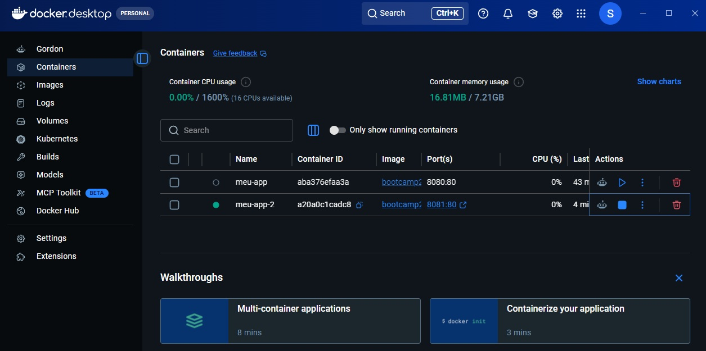

# Pokédex Clássica

## Autor
Felipe Ribeiro — Matrícula 22604250

## Descrição
Uma Pokédex no estilo retro que busca um Pokémon pelo nome ou número, exibe sua imagem oficial, nome e tipos, e permite salvar um time de Pokémon favoritos com persistência em banco de dados real.

## API utilizada
- Nome da API: PokeAPI
- Documentação: https://pokeapi.co/docs/v2
- Endpoint(s) consumido(s): `GET https://pokeapi.co/api/v2/pokemon/{nome-ou-numero}`

## Funcionalidades
- Buscar um Pokémon digitando o nome ou o número na Pokédex (ou pressionando Enter)
- Exibir a imagem oficial, o nome (com número formatado, ex: #025) e os tipos do Pokémon encontrado
- Exibir uma mensagem de erro amigável quando o Pokémon não é encontrado ou a busca falha
- Adicionar o Pokémon exibido ao "Meu Time" (favoritos)
- Listar o time salvo e remover qualquer Pokémon dele

## Persistência de dados
- **Banco:** Supabase (PostgreSQL), acessado direto do frontend via `@supabase/supabase-js`.
- **Tabela:** `favoritos`
  | Coluna | Tipo | Descrição |
  |---|---|---|
  | `id` | gerado automaticamente | identificador do registro |
  | `criado_em` | gerado automaticamente | data/hora de criação |
  | `nome_item` | texto | nome do Pokémon favoritado |
  | `dados_extra` | texto (JSON) | sprite, tipos e número da Pokédex, usados para montar o card do time sem refazer a consulta à PokeAPI |
- **CRUD implementado:** criar (favoritar), listar (carregar o time ao abrir a página) e excluir (botão "remover" em cada item do time). Update não foi necessário para este recurso.
- **Limitação conhecida:** nesta etapa, as políticas de acesso (RLS) da tabela `favoritos` estão abertas para leitura e escrita por qualquer usuário anônimo — não há autenticação de usuário, então o time é compartilhado por quem acessar a aplicação, não individual por visitante.

## Como executar localmente
1. Clone: `git clone https://github.com/felipepribeiro697-debug/BootCampIIAplicacao.git`
2. Abra o arquivo `index.html` no navegador

## Como rodar com Docker
```
docker run -d -p 8080:80 steverogers03/bootcamp2-app:1.0
```
Depois acesse http://localhost:8080

## SQ4 — Explorando a orquestração



Se eu tivesse 100 containers pra gerenciar, rodar e escalar cada um manualmente com `docker run` (um por um, em portas diferentes, como fiz aqui com dois) não seria viável — é exatamente esse problema que ferramentas de orquestração como o **Kubernetes** resolvem. No Kubernetes, cada container roda dentro de um **Pod**, a menor unidade que ele gerencia (geralmente um container só, às vezes mais de um que precisam rodar sempre juntos). Em vez de subir Pods individualmente, eu declararia quantas cópias idênticas da minha aplicação quero rodando ao mesmo tempo — isso é o número de **réplicas**: o Kubernetes mantém esse número automaticamente, recriando um Pod sozinho se ele cair ou travar. Tudo isso roda dentro de um **cluster**, um conjunto de máquinas (nodes) que o Kubernetes enxerga como um recurso só, distribuindo os Pods entre elas e balanceando a carga. Então, ao invés de eu digitar `docker run` 100 vezes, eu descreveria num arquivo (ex: um Deployment do Kubernetes) a imagem `steverogers03/bootcamp2-app` e o número de réplicas desejado, e o cluster cuidaria de criar, distribuir, monitorar e substituir os Pods automaticamente — escalando pra mais ou menos réplicas conforme a demanda.

## Links
- **Aplicação no ar (GitHub Pages):** https://felipepribeiro697-debug.github.io/BootCampIIAplicacao/
- **Repositório:** https://github.com/felipepribeiro697-debug/BootCampIIAplicacao
- **Repositório no Docker Hub:** https://hub.docker.com/r/steverogers03/bootcamp2-app
